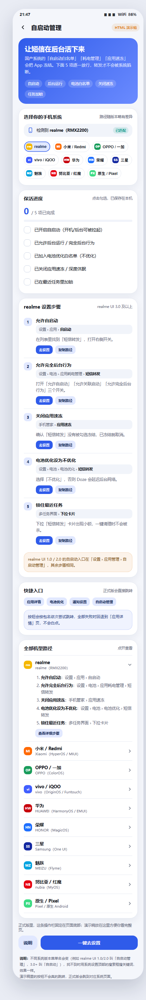

# SmsForward · 短信转发

把安卓手机收到的短信，自动转发到 Telegram、钉钉、企业微信、Server酱、Bark，或者你自己的 Webhook。

人在外面、手机不在手上、或者用电脑工作时，验证码和重要通知也不会错过。



## 能做什么

- **收短信**：读历史短信 + 实时接新短信，四路兜底（系统广播 / 常驻服务 / 短信库监听 / 定时补同步），尽量不漏
- **认验证码**：自动从正文挑出验证码，点一下就复制；转账金额、尾号、订单号不会被当成验证码
- **按规则转发**：全部短信 / 含关键词 / 指定发件人 / 正则，规则可排序、可临时停用
- **6 个渠道**：Telegram、钉钉、企业微信、Server酱、Bark、自定义 Webhook，每个都能一键发测试消息
- **不重复推**：同一条只推一次；清空记录后重新导入旧短信也不会再推
- **保活向导**：自动认手机品牌，给出 realme / 小米 / OPPO / vivo / 华为 / 荣耀 / 三星 / 魅族 / 努比亚 / 原生 的自启动设置步骤，能直接跳到系统页面

## 下载安装

到 [Releases](https://github.com/deng2335/SmsForward/releases) 下载最新的 `SmsForward-x.y.z-debug.apk`（当前 0.2.8，要求 Android 8.0 以上）。

装好后按提示给「短信」和「通知」权限。

## 第一次使用

1. 授权短信、通知
2. 「转发规则」→ 添加一个渠道（比如 Telegram）→ 点「测试」，确认手机上能收到
3. 新建一条规则，勾上刚加的渠道
4. 「设置 → 保活自检」确认服务在跑，再点「自启动管理」，按你的手机品牌放行后台

## 三个注意点

- **短信权限很敏感**：Google Play 不允许非默认短信应用申请，所以这个项目只能自己装（侧载），别上架
- **国产手机会杀后台**：必须按「自启动管理」里的步骤放行，否则可能收不到转发
- **数据只在本机**：短信不上传到任何服务器，只发给你自己配置的渠道

## 自己构建

需要 JDK 17 + Android SDK 35：

```bash
./gradlew assembleDebug
```

产物在 `app/build/outputs/apk/debug/app-debug.apk`。

## 技术栈

Kotlin + Jetpack Compose（Material 3）+ Room + 协程，单 Activity，手写依赖注入，不依赖第三方网络库。

## 版本与许可

当前版本 0.2.8。MIT License，随便用，风险自负。
